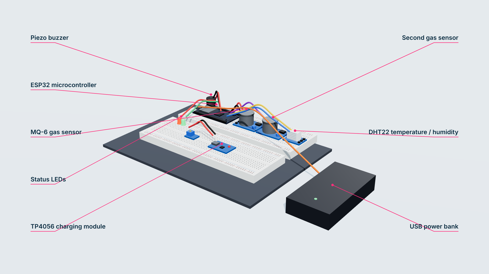
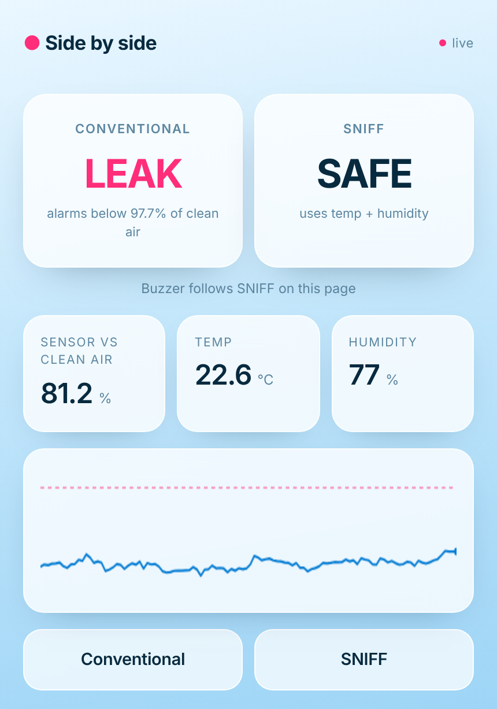

# SNIFF

**Sensor Network for Intelligent Flammable-gas Filtering**

An adaptive gas leak detector. A TensorFlow Lite neural network runs on an
ESP32 and uses temperature and humidity alongside the gas reading, so it can
separate a real leak from a humidity spike. Conventional detectors compare
one sensor reading against one fixed threshold and cannot make that
distinction, which is where their false alarms come from.

The device serves its own Wi-Fi network and a live dashboard, so the
classifier's decision is visible without a laptop or an internet connection.



---

## The result

Three detectors were built and evaluated on the same recorded data, across 12
random session splits with whole sessions held out each time.

| Detector | Accuracy | Leaks caught | False alarms, humid air |
|---|---|---|---|
| Conventional fixed threshold | 91.7% ± 6.0 | 90.7% | 14.2% |
| **Threshold corrected for T and RH** | **95.3% ± 3.3** | **94.6%** | **0.3%** |
| Neural network, 234 parameters | 79.7% ± 15.7 | 86.1% | 11.4% |

Correcting for temperature and humidity cut false alarms in humid air by
roughly 40x while catching *more* real leaks, not fewer. The neural network
lost to both: at 16 sessions it swings ±15.7 points depending on the split,
which is a data-quantity result rather than a verdict on the approach. Both
findings are reported here rather than only the favourable one.


## The problem, measured

Two five-minute recordings, **no gas present in either**. The only difference
is a damp cloth in the chamber; temperature is matched to within 0.2 °C. The
humid trace drops below a conventional detector's trip point and stays there.


The live dashboard during that same condition, with the conventional
threshold and the classifier side by side on the same sample:



## Build and test rig

| | |
|---|---|
|  |  |
| The assembled unit | Sealed 12.3 L chamber, damp cloth, butane |

## Why this is not just a threshold

The MQ-6 senses through tin dioxide. Adsorbed oxygen traps electrons and
holds resistance high; a reducing gas such as propane frees them and
resistance drops. Water vapour acts through the same pathway and drops
resistance the same direction. From a single resistance measurement the two
are not distinguishable.

The MQ-6 datasheet states that the alarm point should be determined only
after accounting for temperature and humidity. This project implements that
as a learned decision boundary over four inputs rather than one compensated
constant.

## Layout

```
collect.py                      session logger, laptop side
make_synthetic.py               simulated session generator (marked SYNTH_)
train_tflite.py                 training, baselines, int8 export    <- CURRENT
train.py                        earlier scikit-learn path           <- superseded

firmware/sniff_logger/          data collection firmware
firmware/sniff_web/             inference + Wi-Fi dashboard         <- FLASH THIS
  model_data.h                  generated by train_tflite.py
firmware/_superseded/           earlier sketches, kept for reference only

data/                           sessions, one CSV each
results/
  metrics_tflite.json           current metrics
  fig1_humidity_effect.png
  fig2_false_alarms.png
docs/                           figures and photographs
RUN_TODAY.md                    collection and demo runbook
```

## Hardware

| Pin | Connection |
|---|---|
| GPIO34 | MQ-6 AOUT through a 10k/10k divider |
| GPIO27 | DHT22 data |
| GPIO26 | DHT22 power, held HIGH |
| GPIO33 | Red LED + 220 Ω |
| GPIO25 | Green LED + 220 Ω |
| GPIO13 | Active buzzer |

Two design points worth stating in the report:

**The divider is required.** The MQ-6 swings 0–5 V and the ESP32 ADC pin
tolerates 3.3 V. Two 10 kΩ resistors halve it, which also keeps the signal
inside the linear part of the ADC range.

**GPIO34 is on ADC1.** ADC2 is claimed by the Wi-Fi driver and stops working
the moment the driver starts. Since this design runs a SoftAP, the gas
channel has to live on ADC1. This is not a preference; ADC2 would silently
return garbage.

Measured clean-air baseline on the assembled unit: **Ro = 19.42 kΩ**.

## Model

Four inputs: sensing resistance normalised to the unit's own clean-air Ro,
temperature, relative humidity, and the rate of change of resistance over a
ten second window.

The fourth input is the one a fixed threshold structurally cannot use. A
leak develops over seconds; ambient humidity drifts over hours. The two are
separated by orders of magnitude in their time constants.

| | |
|---|---|
| Architecture | 4 → 16 → 8 → 2, ReLU, softmax |
| Parameters | 234 |
| Flatbuffer | 3,440 bytes, full int8 post-training quantization |
| Runtime | TensorFlow Lite Micro, `MicroMutableOpResolver<4>` |
| Tensor arena | 16 KB allocated |

The op resolver registers only FullyConnected, Softmax, Quantize and
Dequantize. Registering four ops instead of linking the full resolver is
what keeps the interpreter's flash cost small.

### Footprint, measured from the build

| | |
|---|---|
| Flash | 1,014,196 bytes, 77% of the partition |
| RAM | 65,856 bytes, 20% |

### Quantization cost

Full int8 quantization was performed with a representative dataset drawn
from the training split. Measured cost against the float32 Keras model:
**+0.00 percentage points** of accuracy. The int8 model is not a degraded
approximation here; at 234 parameters the weight distribution quantizes
cleanly.

## Dashboard

The ESP32 runs a SoftAP. There is no router and no internet involved, which
is deliberate: the demo has to work in a classroom with no credentials to
hand out, and a gas detector that depends on someone else's network is a
worse gas detector.

| | |
|---|---|
| SSID | `SNIFF-Detector` |
| Password | `sniffgas2026` |
| Address | `http://192.168.4.1` |

The page is served from PROGMEM with no external resources, because a
client joining a network with no internet cannot fetch a CDN. It polls `/d`
for JSON and draws a rolling 120-second history, the live classifier
decision, and the fixed-threshold decision side by side.

Serial commands at 115200:

| Key | Effect |
|---|---|
| `c` | recalibrate Ro, 60 s in clean air |
| `r` | print the stored Ro |
| `m` | toggle mute, **this is a toggle and it latches** |
| `t` | self-test, asserts the alarm for 4 s |

## Methodology notes that matter under review

**Sessions are held out whole, never rows.** Samples recorded one second
apart are near duplicates. A random row split puts them in both train and
test and inflates accuracy into something meaningless. `train_tflite.py`
splits by `session_id` and warns loudly if there are too few sessions for
that.

**Recall on the leak class is the primary metric.** The dataset skews toward
safe conditions, so a model that always answers "safe" scores well on
accuracy while catching nothing. The reported numbers are the confusion
matrix, per-class precision and recall, and the false alarm rate measured
specifically in humid air with no gas.

**The baseline is built and measured, not assumed.** `train_tflite.py`
constructs two conventional detectors: a fixed threshold tuned on the
training set, and a threshold with temperature and humidity compensation
fitted on clean-air data. Both are evaluated on the identical held-out set.
That comparison is the contribution of the project, not the classifier on
its own.

If the model does not beat the compensated threshold, the script says so in
plain language. Report it. A measured negative result is a finding; an
unmeasured advantage is not.

## Data provenance

**The committed model is trained on simulated sessions, not recorded ones.**
Every simulated file is prefixed `SYNTH_`, its notes column reads
`simulated - make_synthetic.py`, and `metrics_tflite.json` and
`model_data.h` both carry `data source: simulated`. The sessions come from
the physical model in `make_synthetic.py`, which follows the MQ-6
datasheet's response shape, not from a sensor.

They exist so the pipeline (collect → train → quantize → export → flash →
demo) could be built and verified end to end before chamber time. Any
performance number taken from them describes the simulation, not the
device.

To replace them with recorded data:

```bash
python make_synthetic.py --clean
# record sessions per RUN_TODAY.md
python train_tflite.py
# reflash firmware/sniff_web
```

Do not mix the two in one training run. The metrics would then describe
neither.

## Safety

All testing is capped at 2,000 ppm, one tenth of propane's lower explosive
limit and the accepted industrial margin for work in a potentially
flammable atmosphere. The MQ-6 detects from 200 ppm, so the sensor's useful
range sits entirely below any concentration that could ignite. `collect.py`
refuses a `--gas` argument above the cap.

The MQ-6's stainless steel mesh is a flame arrestor, which is why a heated
sensing element is safe to operate around combustible gas at these levels.

## Usage

```bash
pip install pyserial numpy pandas scikit-learn matplotlib tensorflow

python collect.py --list-ports
python collect.py --port PORT --gas 0 --rh humid --duration 600
python train_tflite.py
# flash firmware/sniff_web, model_data.h is already beside it
```

See `RUN_TODAY.md` for the full collection protocol.
