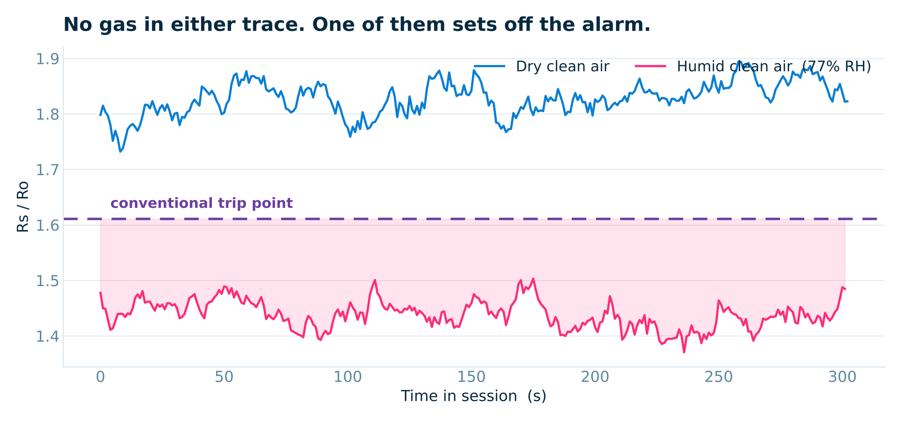
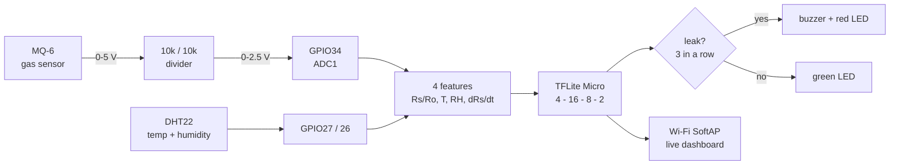
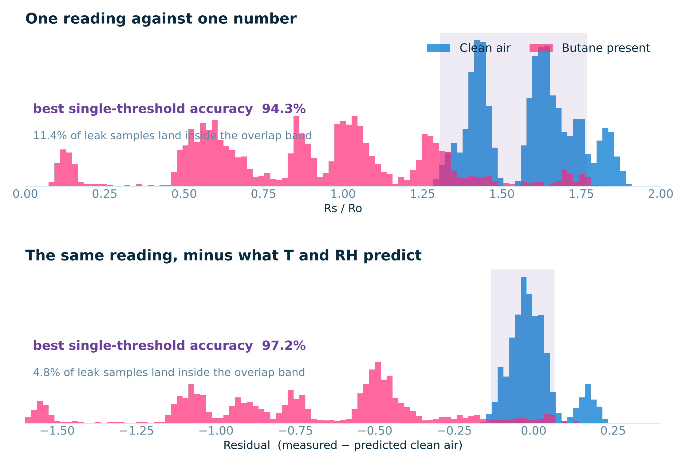
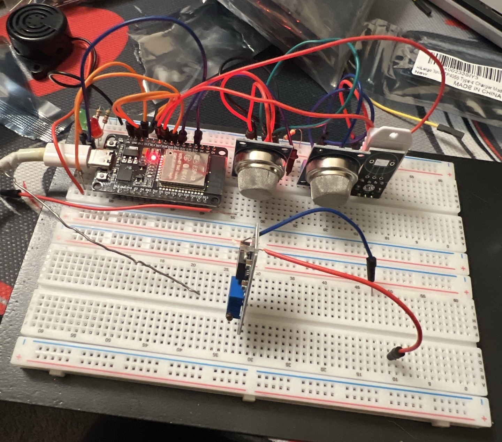
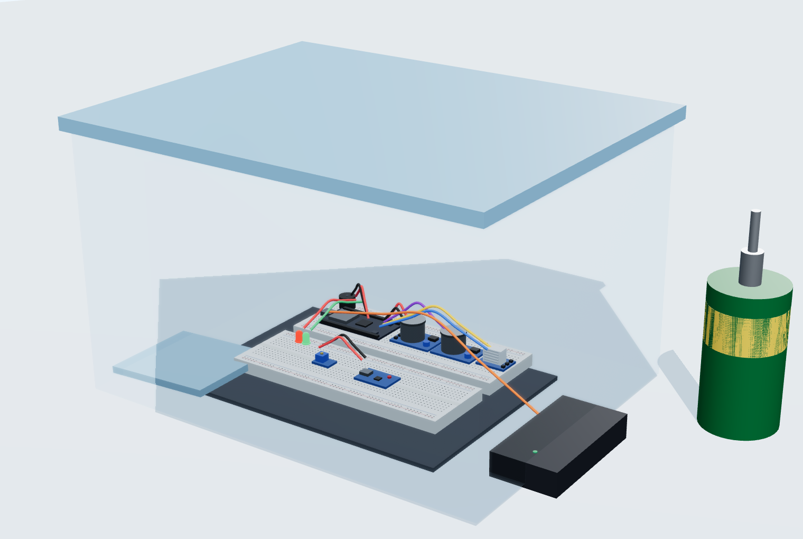

<div align="center">

# SNIFF

**Sensor Network for Intelligent Flammable-gas Filtering**

A gas leak detector that knows the difference between a propane leak and a hot shower.

[](https://www.espressif.com/en/products/socs/esp32)
[](https://ai.google.dev/edge/litert/microcontrollers/overview)
[](firmware/sniff_web/model_data.h)
[](#footprint)
[](LICENSE)


</div>

---

> **The one-sentence version.** Every household gas detector compares one sensor
> reading against one fixed number. Water vapour moves that reading in the same
> direction a gas leak does, through the same surface chemistry, so a
> single-threshold detector cannot tell a leak from a steamy bathroom. SNIFF
> measures temperature and humidity too, and decides on-device in under a second.

## Contents

- [Why gas detectors false alarm](#why-gas-detectors-false-alarm)
- [How it works](#how-it-works)
- [Results](#results)
- [What the data actually showed](#what-the-data-actually-showed)
- [Hardware](#hardware)
- [The model](#the-model)
- [Dashboard](#dashboard)
- [Reproducing this](#reproducing-this)
- [Method notes](#method-notes)
- [Safety](#safety)

## Why gas detectors false alarm

The MQ-6 senses through tin dioxide. Adsorbed oxygen traps electrons and holds
resistance high. A reducing gas such as propane frees them, resistance drops,
and the alarm fires. **Water vapour frees the same electrons through the same
pathway and drops resistance the same direction.**

From a single resistance measurement the two are not distinguishable, and not
because the sensor is cheap. The information is not there.

Below are two five-minute recordings with **no gas present in either one**. The
only difference is a damp cloth in the chamber, and temperature is matched to
within 0.2 degC. The humid trace falls below a conventional detector's trip
point almost immediately and never returns.



The MQ-6 datasheet says the alarm point should only be set after accounting for
temperature and humidity. This project does that as a learned decision boundary
over four inputs rather than one compensated constant.

## How it works



The fourth input is the one a fixed threshold structurally cannot use. **A leak
develops over seconds; ambient humidity drifts over hours.** The two are
separated by orders of magnitude in their time constants, and a detector that
looks at a single instantaneous reading has thrown that away before it starts.

Three detectors run **simultaneously on the same chip, on the same sample**, so
the baseline is measured rather than described:

| | Decision rule |
|---|---|
| Conventional | `alarm if Rs/Ro < k` |
| Compensated | `alarm if Rs/Ro - f(T, RH) < k` |
| SNIFF | 4 - 16 - 8 - 2 neural network |

## Results

Twelve random session splits, whole sessions held out each time, stratified
across the humidity and gas conditions. Reproduce with
[`analysis/repeated_splits.py`](analysis/repeated_splits.py); raw output in
[`results/repeated_splits.json`](results/repeated_splits.json).

| Detector | Accuracy | Leaks caught | False alarms, humid air |
|---|---|---|---|
| Conventional fixed threshold | 91.7% ± 6.0 | 90.7% | 14.2% |
| **Threshold corrected for T and RH** | **95.3% ± 3.3** | **94.6%** | **0.3%** |
| TinyML, 234 parameters | 77.4% ± 13.4 | 85.7% | 7.8% |

Measuring temperature and humidity cut false alarms in humid air from **14.2%
to 0.3%**, a factor of roughly fifty, while catching **more** real leaks rather
than fewer. The gain was not bought by making the detector deaf.



Top panel: every recorded sample by its raw reading. Where the two groups
overlap, no threshold can separate them. Bottom panel: the same samples measured
against what clean air *should* read at that temperature and humidity. The
groups pull apart, and the best achievable single-threshold accuracy rises from
**94.3% to 97.2%**.

The live dashboard during a humid, gas-free condition, with the conventional
threshold and the classifier side by side on the same sample:

<div align="center">

</div>

## What the data actually showed

**The neural network lost, to both baselines.** A three-coefficient linear
correction beat a 234-parameter network, and it was not close.

The standard deviations are the reason. Across the twelve splits the network's
accuracy swings **± 13.4 points** depending on which sessions are held out, and
its false alarm rate in *dry* air averages 54%. At 16 sessions from one unit on
one collection day, it is not learning a stable rule.

That is a statement about dataset size, not about the approach. The premise of
the project held: adding temperature and humidity to the decision works, and
works dramatically. The specific method chosen to exploit it needs an order of
magnitude more data than this build collected.

This is reported here because a measured negative result is a finding and an
unmeasured advantage is not. `train_tflite.py` says so in plain language when
the model fails to beat the compensated threshold, by design.

## Hardware

<table>
<tr>
<td width="50%"></td>
<td width="50%"></td>
</tr>
<tr>
<td align="center"><em>The assembled unit</em></td>
<td align="center"><em>Sealed 12.3 L chamber, damp cloth, butane</em></td>
</tr>
</table>

| Pin | Connection |
|---|---|
| `GPIO34` | MQ-6 AOUT through a 10k/10k divider |
| `GPIO27` | DHT22 data |
| `GPIO26` | DHT22 power, held HIGH |
| `GPIO33` | Red LED + 220 ohm |
| `GPIO25` | Green LED + 220 ohm |
| `GPIO13` | Active buzzer |

Measured clean-air baseline on the assembled unit: **Ro = 19.42 kohm**, stored in
NVS so it survives a reflash.

<details>
<summary><b>Two design decisions worth defending</b></summary>

<br>

**The divider is required, not a precaution.** The MQ-6 module swings across the
full 0-5 V supply and the ESP32 ADC pin is rated to 3.3 V. Two 10 kohm resistors
halve the signal, which also keeps it inside the more linear part of the
converter's range. This was learned the hard way: an early calibration run
returned `Rs = 0.00 kohm` on all sixty samples because the divider had been
bypassed and the pin was saturated.

**GPIO34 is on ADC1, and it has to be.** The ESP32's ADC2 block is claimed by the
Wi-Fi driver and stops returning valid conversions the moment that driver
starts. Since this design runs a SoftAP for the dashboard, the gas channel cannot
live on ADC2. The failure would have been silent, which makes it worse than a
loud one.

</details>

## The model

| | |
|---|---|
| Architecture | 4 - 16 - 8 - 2, ReLU hidden, softmax output |
| Parameters | 234 |
| Flatbuffer | **3,496 bytes**, full int8 post-training quantization |
| Runtime | TensorFlow Lite Micro, `MicroMutableOpResolver<4>` |
| Tensor arena | 16 KB |
| Inference rate | 1 Hz, alarm requires 3 consecutive leak samples |

The op resolver registers only `FullyConnected`, `Softmax`, `Quantize` and
`Dequantize`. Registering four operators instead of linking the full resolver is
what keeps the interpreter's flash cost reasonable.

#### Footprint

| | |
|---|---|
| Flash | 1,014,196 bytes, **77%** of the partition |
| RAM | 65,856 bytes, **20%** |

Int8 quantization used a representative dataset drawn from the training split.
Measured cost against the float32 Keras model: **+3.06 percentage points**. The
memory argument for TinyML was never the binding constraint on this design. Data
collection was.

## Dashboard

The ESP32 runs its own access point. There is no router and no internet
involved, which is deliberate: a gas detector that depends on someone else's
network is a worse gas detector.

| | |
|---|---|
| SSID | `SNIFF-Detector` |
| Address | `http://192.168.4.1` |

The page is served from PROGMEM with no external resources, because a client
joining a network with no internet cannot fetch a CDN. It polls `/d` for JSON
and draws a rolling 120-second history, the live classifier decision, and the
fixed-threshold decision side by side.

<details>
<summary><b>Serial commands at 115200 baud</b></summary>

<br>

| Key | Effect |
|---|---|
| `c` | recalibrate Ro, 60 s in clean air |
| `r` | print the stored Ro |
| `m` | toggle mute, **this latches** |
| `t` | self-test, asserts the alarm for 4 s |
| `b` | re-baseline the conventional detector |

</details>

## Reproducing this

```bash
pip install pyserial numpy pandas scikit-learn matplotlib tensorflow

# train, evaluate against both baselines, export the C array
python train_tflite.py

# the cross-split stability analysis behind the results table
python analysis/repeated_splits.py --splits 12

# flash firmware/sniff_web, model_data.h is already beside it
```

To record new sessions, see [`RUN_TODAY.md`](RUN_TODAY.md) for the collection
protocol, then:

```bash
python collect.py --list-ports
python collect.py --port PORT --gas 0 --rh humid --duration 600
```

## Method notes

**Sessions are held out whole, never rows.** Samples recorded one second apart
are near duplicates. A random row split puts them in both train and test and
inflates accuracy into something meaningless. `train_tflite.py` splits by
`session_id` and warns loudly when there are too few sessions for that.

**Leak recall is the primary metric, not accuracy.** A model that always answers
"safe" scores well on accuracy while catching nothing. Reported numbers are the
confusion matrix, per-class precision and recall, and the false alarm rate
measured specifically in humid air with no gas.

**The baseline is built and measured, not assumed.** `train_tflite.py`
constructs both conventional detectors and evaluates them on the identical
held-out set. That comparison is the contribution, not the classifier alone.

<details>
<summary><b>Data provenance, and what did not make it in</b></summary>

<br>

The committed model is trained on **recorded sensor data**: 16 sessions, 4,840
samples at 1 Hz, dry and humid crossed with gas and no-gas, four replicates
each. Gas was Bernzomatic butane, vapour phase, released into a sealed 12.3 L
container; humidity came from a damp cloth with no gas present. Both
`metrics_tflite.json` and `model_data.h` carry `data source: measured`.

`raw/` is kept deliberately, including the work that failed:

| Folder | What it is |
|---|---|
| `raw/simulated_superseded/` | `SYNTH_` sessions from `make_synthetic.py`, used to build and verify the whole pipeline before any chamber time. Superseded by recorded data. |
| `raw/run1_saturated_discarded/` | A full collection run thrown away because the doses saturated the sensor. Reasoning in `WHY_DISCARDED.txt`. |
| `raw/empty_failed_run/` | An 80-minute run that captured nothing, because the logger verified the reader process was alive rather than that data was arriving. |

Known limitations, stated up front: gas concentrations were nominal rather than
metered; ambient temperature fell 8.2 degC across the run because venting was
done at an open window; one unit on one collection day, so nothing here speaks
to unit-to-unit variation or day-to-day repeatability.

</details>

## Safety

Testing is capped at 2,000 ppm, one tenth of propane's lower explosive limit and
the accepted industrial margin for work in a potentially flammable atmosphere.
The MQ-6 detects from 200 ppm, so the sensor's useful range sits entirely below
any concentration that could ignite, and `collect.py` refuses a `--gas` argument
above the cap.

The MQ-6's stainless steel mesh is a flame arrestor, which is why a heated
sensing element is safe to operate around combustible gas at these levels.

## Repository layout

```
train_tflite.py                 training, baselines, int8 export     <- CURRENT
analysis/repeated_splits.py     cross-split stability analysis
collect.py                      session logger, laptop side
make_synthetic.py               simulated session generator
train.py                        earlier scikit-learn path            <- superseded

firmware/sniff_web/             inference + Wi-Fi dashboard          <- FLASH THIS
  model_data.h                  generated by train_tflite.py
firmware/sniff_logger/          data collection firmware
firmware/_superseded/           earlier sketches, reference only

data/                           16 recorded sessions
raw/                            raw captures, including discarded runs
results/                        measured metrics
docs/                           figures and photographs
HARDWARE.md                     pin map, rationale, calibration
RUN_TODAY.md                    collection and demo runbook
```

## License

[MIT](LICENSE) (c) 2026 Ayaan Khan
